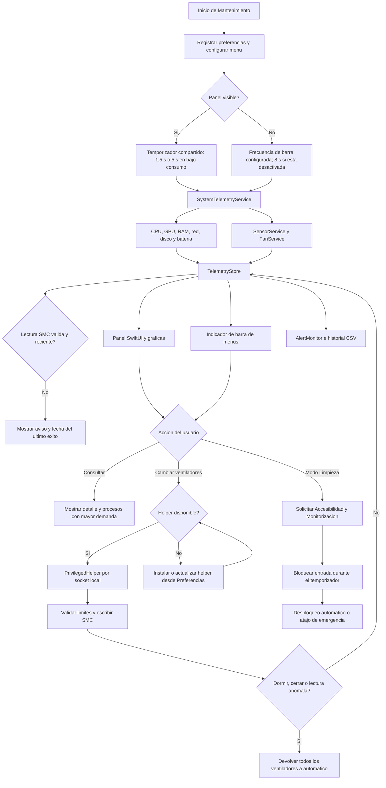

<div align="center">
  
  <h1>Mantenimiento</h1>
  <p>Diagnostico, telemetria y mantenimiento seguro para macOS</p>

  <p>
    
    
    
    
  </p>
</div>

Mantenimiento es una utilidad nativa de macOS para consultar el estado del equipo, revisar sensores y ventiladores, controlar temporalmente la refrigeracion y bloquear la entrada durante la limpieza externa del MacBook.

El proyecto combina una ventana de diagnostico completa con un indicador compacto en la barra de menus. La aplicacion prioriza lecturas fiables, actualizaciones suaves y guardarrailes para devolver los ventiladores a automatico cuando dejan de estar bajo control seguro.

## Funcionalidades

### Diagnostico y telemetria

- CPU total y uso por nucleo con núcleos de rendimiento y eficiencia, reparto usuario/sistema, carga media y número de procesos.
- Uso de GPU cuando macOS expone la metrica a traves de IOKit.
- Memoria usada, memoria fisica, presion de memoria, cache, swap, compresión y paginación.
- Temperaturas por componente y temperatura maxima; catálogo de sensores según el chip (M1, M2, M3 y M4 o posterior).
- Ventiladores: RPM actual, minimo, maximo, objetivo y modo.
- Potencia, voltaje y corriente de sensores SMC disponibles.
- Red: conexión principal, router, DNS y latencia real a Internet; Wi-Fi con banda, canal, ancho, estándar, seguridad, señal y ruido; interfaces con IP, MAC, velocidad de enlace, MTU y errores (contadores de 64 bits).
- Tráfico por aplicación (TCP y UDP), actual y acumulado, agrupando los procesos auxiliares con su app.
- Los túneles internos de macOS (iCloud, Continuidad, AirDrop) se agrupan aparte; las VPN con dirección propia se muestran como interfaces normales.
- Disco de arranque con modelo, estado SMART y cifrado; actividad de lectura y escritura con operaciones por segundo; todos los volúmenes montados con uso y expulsión de los externos.
- Qué ocupa espacio (bajo demanda y solo lectura): cachés, Descargas, papelera, copias de iPhone, datos de Xcode y simuladores, registros, adjuntos de Mail, archivos grandes en Descargas e instantáneas locales de Time Machine, con acceso directo al Finder. Nunca borra nada.
- Arranque y segundo plano: LaunchAgents y LaunchDaemons instalados, con fabricante, si están en ejecución o desactivados y aviso de los que apuntan a programas que ya no existen.
- Impacto energético por aplicación (la misma escala que Monitor de Actividad), agrupando los procesos auxiliares con su app.
- Salud de la batería a largo plazo: una medición diaria de la capacidad real para ver su evolución y la pérdida cada 100 ciclos.
- Batería: capacidad real y de diseño en mAh, ciclos sobre los de diseño, condición, voltaje, amperaje, potencia de carga o descarga, tiempo restante, carga en pausa y datos del cargador.
- Flujo de energía: potencia de entrada del cargador frente al consumo del sistema.
- Icono de batería en la barra lateral que refleja el nivel y muestra el rayo al cargar.
- Seguridad del sistema: SIP, FileVault, Gatekeeper y firewall.
- Revisión de mantenimiento en el resumen: espacio en disco, días encendido, memoria, swap, batería y seguridad.
- Registro de actividad (30 días): alertas, cargador, suspensión, estado térmico, ventiladores y perfiles.
- Procesos con mayor demanda de CPU, GPU o memoria.
- Graficas en vivo e historial CSV de siete dias visualizable por última hora, 24 horas y 7 días.

### Alertas

- Temperatura, presión de memoria, ventilador sin respuesta y consumo de la propia app.
- Poco espacio en el disco de arranque, con umbral configurable.
- Procesos con CPU alta sostenida (bucles o apps colgadas), con umbral y duración configurables.

### Ventiladores

- Modo automatico para devolver el control a macOS.
- Control manual experimental con limites de seguridad.
- Accion Turbo para llevar todos los ventiladores a su maximo permitido.
- Perfiles Silencioso, Equilibrado y Turbo.
- Restauracion automatica al cerrar, dormir, despertar o detectar lecturas anomalas.
- Helper privilegiado local para no solicitar una contrasena en cada cambio.
- Control manual exclusivamente mediante el helper v3, con órdenes serializadas, identificadores de petición y confirmación de Auto durante hasta 5 segundos, sin repetir escrituras.
- Supervisión del cliente con una concesión de 30 segundos; si la app cae o deja de renovarla, el helper intenta restaurar Auto y reintenta si falla.
- Marcador de recuperación persistente para restaurar el control después de reiniciar el helper; rollback global ante operaciones manuales fallidas.

### Modo Limpieza

- Bloqueo temporal de teclado, raton y trackpad durante 1, 2 o 5 minutos.
- Desbloqueo automatico al terminar el temporizador.
- Desbloqueo de emergencia con `Control + Option + Command + Esc`.
- Comprobacion de permisos de Accesibilidad y Monitorizacion de entrada.

### Interfaz

- Ventana redimensionable con barra lateral por areas.
- Apertura opcional al iniciar sesión desde Preferencias.
- Conserva el tamaño y la posición de la ventana entre aperturas.
- Panel de estado rapido con CPU, GPU, RAM, red y temperaturas.
- Indicador configurable en la barra de menus.
- Desplegables de detalle por metrica y demanda por proceso.
- Desplegable ajustado al contenido y al espacio disponible de la pantalla; solo requiere desplazamiento cuando no cabe completo.
- Acciones del desplegable siempre fuera del área desplazable y diagnóstico exportable sin rutas personales ni argumentos de procesos.
- Actualizacion normal cada 1,5 segundos y modo ligero cuando el panel no esta visible.
- Valores numéricos actualizados directamente; animaciones suaves en gráficas e indicadores de progreso.
- Una muestra compartida para la ventana y la barra, con fechas de última lectura válida y avisos de datos no disponibles.
- Gráficas adaptables con aprovechamiento de la última fila y subida/bajada de red en líneas separadas.
- Puntos de gráfica con identidad estable y tramos separados cuando faltan lecturas; las tasas de disco usan su propio intervalo real.
- Perfil Silencioso respetado con el panel abierto y menos trabajo de la ventana cuando queda oculta.
- Colores y materiales inspirados en las convenciones de macOS.

## Tecnologias

| Area | Tecnologia |
| --- | --- |
| Lenguaje principal | Swift 5.9+ |
| Interfaz | SwiftUI integrado en AppKit |
| Integracion de macOS | AppKit, IOKit, SMC, NSWorkspace y ProcessInfo |
| Telemetria | APIs del sistema, IOKit y AppleSMC cuando estan disponibles |
| Persistencia | UserDefaults para preferencias e historial CSV local |
| Control privilegiado | Helper v3 por socket Unix, sin fallback automático de contraseña |
| Distribucion | Bundle `.app`, codesign y soporte de notarizacion |
| Plataforma | macOS 13 o posterior |

El proyecto esta escrito practicamente en su totalidad en **Swift**. Los scripts de construccion y empaquetado utilizan **Bash**, y el icono se genera con un pequeno script de **Swift + AppKit**.

## Arquitectura

El repositorio se divide en tres ejecutables y una biblioteca compartida:

```text
Sources/
├── Mantenimiento/          Aplicacion principal, UI, menu y preferencias
├── MantenimientoCore/      Telemetria, SMC, sensores y ventiladores
├── MantenimientoFanTool/   Herramienta CLI para diagnostico y control
└── MantenimientoHelper/    Helper privilegiado para operaciones SMC
```

### Componentes principales

- `MantenimientoCore`: concentra el acceso a AppleSMC, sensores, ventiladores y snapshots de sistema.
- `TelemetryStore`: serializa y comparte las muestras; conserva por separado las fechas del último éxito y los errores de sensores y ventiladores. Un temporizador alimenta ventana y barra. Los datos fallidos o antiguos no se usan como lecturas actuales.
- `DiagnosticsWindowController`: ventana principal, navegacion lateral, estado y acciones; cada sección vive en su propio archivo `Diagnostics*Section.swift` y los componentes compartidos en `DiagnosticsComponents.swift`.
- `StorageAnalyzer`, `LaunchItemsScanner` y `BatteryHealthLog`: análisis de espacio, elementos de arranque y registro diario de la batería, todos de solo lectura salvo el propio registro.
- `AppDelegate`: ciclo de vida, indicador de barra, menu contextual y restauracion de seguridad.
- `PrivilegedHelperClient`: comunicacion limitada con el helper mediante socket local.
- `MantenimientoHelper`: proceso separado con privilegios minimos para escribir objetivos SMC.
- `MantenimientoFanTool`: comandos JSON y acciones de ventiladores para diagnostico desde terminal.

## Diagrama de flujo



## Seguridad y permisos

La aplicacion no necesita privilegios para consultar la mayoria de metricas. macOS puede solicitar:

- **Accesibilidad** y **Monitorizacion de entrada** para el Modo Limpieza.
- **Ubicación** solo si quieres ver el nombre de la red Wi-Fi; el resto de datos del Wi-Fi no lo necesita.
- Acceso a **Descargas** al analizar el espacio, y **Acceso total al disco** si quieres medir también la papelera, las copias de iPhone o los adjuntos de Mail.
- Autorizacion de administrador al instalar o actualizar el helper, nunca como reintento automático de una orden de ventiladores.

El helper es opcional para consultar métricas y obligatorio para el control manual desde la app. Valida UID, PID, ruta y firma del cliente; limita conexiones y peticiones y serializa las operaciones SMC. La instalación verifica la copia del ejecutable en un directorio protegido de root, utilizando el mismo certificado de la app, y no ejecuta scripts temporales modificables por el usuario.

Después de actualizar a 0.3.0, abre **Preferencias > Helper > Instalar helper** si aparece **Actualización necesaria**. Requiere una autorización de administrador. La app no actualizará el servicio privilegiado sin esa acción y no permite control manual con el helper antiguo.

La supervisión y el rollback son medidas de recuperación de mejor esfuerzo: si el firmware rechaza Auto, el error se conserva y el helper reintenta. No sustituyen las protecciones térmicas del hardware. Las pruebas automatizadas utilizan un SMC simulado, sin escribir en los ventiladores reales.

## Construir

Requisitos:

- macOS 13 o posterior.
- Xcode Command Line Tools o Xcode.
- Swift 5.9 o posterior.

Construccion del bundle:

```bash
./Scripts/build-app.sh
```

El resultado se genera en `.build/release/Mantenimiento.app`.

Instalacion en Aplicaciones y arranque:

```bash
./Scripts/install-app.sh
./script/build_and_run.sh
```

Comprobacion de compilacion, instalacion y arranque:

```bash
./script/build_and_run.sh --verify
codesign --verify --deep --strict /Applications/Mantenimiento.app
```

## Pruebas

Las pruebas de telemetría utilizan Swift Testing y requieren Swift 6 o posterior:

```bash
bash Scripts/test.sh
```

Cubren reutilización y caducidad de muestras, fallo y recuperación de sensores, rollback de Turbo, timeout de control manual, errores de Auto, límites de RPM, lectura inválida, concesión de supervisión, formato de peticiones, tasas de disco, tramos de gráficas, exportación del historial, límites de altura del desplegable, catálogo de sensores por chip, lectura y agregación del historial, amperaje de la batería y detección de procesos con CPU sostenida.

La retención del historial se comprueba durante la ejecución y al exportar, no solo al iniciar. La demanda de red del menú está limitada a TCP; el tráfico por aplicación del panel incluye TCP y UDP. Las estimaciones de GPU se identifican como tales.

Los scripts de construcción, instalación y pruebas aceptan `MACOS_SDK_PATH` y `SWIFT_BUILD_SYSTEM` para elegir un SDK y motor de compilación instalados. Por ejemplo, si las Command Line Tools no incluyen los plugins SwiftUI del SDK más nuevo:

```bash
export MACOS_SDK_PATH=/Library/Developer/CommandLineTools/SDKs/MacOSX26.5.sdk
export SWIFT_BUILD_SYSTEM=native
bash Scripts/test.sh
./Scripts/install-app.sh
```

`install-app.sh` vuelve a construir el bundle, por lo que también necesita estas variables.

### Verificación en GitHub

El workflow `Verify macOS app` se inicia manualmente desde Actions con `Run workflow`. No incluye disparadores periódicos ni se ejecuta automáticamente al publicar cambios.

Comprueba la sintaxis de los scripts, ejecuta las pruebas, construye el bundle de producción y valida su firma y recursos. No instala el helper, no modifica ventiladores y no necesita certificados privados: utiliza firma ad hoc solo para comprobar el empaquetado.

Se configura con macOS 15 y Xcode 16.4, disponibles en las [imágenes oficiales de GitHub Actions](https://github.com/actions/runner-images/blob/main/images/macos/macos-15-Readme.md). La ejecución remota debe verificarse tras publicar el workflow en el repositorio.

## Herramienta de consola

Despues de construir el proyecto:

```bash
.build/release/mantenimiento-fanctl status-json
.build/release/mantenimiento-fanctl list-json
.build/release/mantenimiento-fanctl sensors-json
.build/release/mantenimiento-fanctl system-json
.build/release/mantenimiento-fanctl auto-all
.build/release/mantenimiento-fanctl turbo
```

`status-json` devuelve un resumen compacto para scripts (CPU, carga, memoria, swap, disco, temperatura máxima, ventiladores, batería y estado térmico); las lecturas no disponibles se omiten.

## Helper privilegiado

Para instalar el helper persistente:

```bash
./Scripts/install-helper.sh
```

Se instala como LaunchDaemon en:

```text
/Library/LaunchDaemons/local.marc.mantenimiento.helper.plist
```

Para eliminarlo:

```bash
./Scripts/uninstall-helper.sh
```

La distribucion notarizada requiere una identidad `Developer ID Application` y un perfil de `notarytool` configurado en el llavero:

```bash
DEVELOPER_ID_APPLICATION='Developer ID Application: ...' \
NOTARY_PROFILE='mantenimiento-notary' \
./Scripts/package-notarized.sh
```

## Limitaciones conocidas

Las lecturas dependen de lo que el hardware y la version de macOS expongan publicamente. En algunos equipos pueden faltar GPU avanzada por proceso, frecuencias por nucleo, ANE, energia por proceso o determinados sensores SMC. La escritura de ventiladores es experimental y debe usarse con criterio, especialmente durante cargas sostenidas.

## Estado del proyecto

Proyecto personal en desarrollo activo. Las operaciones de lectura estan pensadas para ser seguras y no invasivas; las operaciones de escritura SMC permanecen protegidas por limites, autorizacion y restauracion a automatico.

## Licencia

No se ha publicado todavia una licencia de redistribucion. Consulta `THIRD_PARTY_NOTICES.md` para las dependencias y avisos incluidos.
