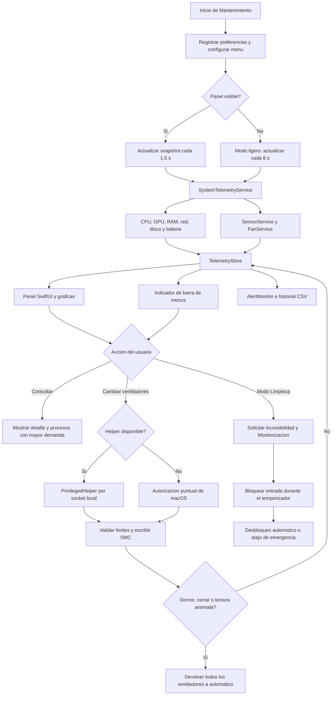

<div align="center">
  
  <h1>Mantenimiento</h1>
  <p>Diagnostico, telemetria y mantenimiento seguro para macOS</p>

  <p>
    
    
    
    
  </p>
</div>

Mantenimiento es una utilidad nativa de macOS para consultar el estado del equipo, revisar sensores y ventiladores, controlar temporalmente la refrigeracion y bloquear la entrada durante la limpieza externa del MacBook.

El proyecto combina una ventana de diagnostico completa con un indicador compacto en la barra de menus. La aplicacion prioriza lecturas fiables, actualizaciones suaves y guardarrailes para devolver los ventiladores a automatico cuando dejan de estar bajo control seguro.

## Funcionalidades

### Diagnostico y telemetria

- CPU total y uso por nucleo, ordenado por numeracion estable.
- Uso de GPU cuando macOS expone la metrica a traves de IOKit.
- Memoria usada, memoria fisica, presion de memoria, cache y swap.
- Temperaturas por componente y temperatura maxima.
- Ventiladores: RPM actual, minimo, maximo, objetivo y modo.
- Potencia, voltaje y corriente de sensores SMC disponibles.
- Velocidad de red de subida y bajada.
- Lecturas de disco e I/O.
- Estado de bateria, ciclos, salud y temperatura cuando el equipo lo expone.
- Procesos con mayor demanda de CPU, GPU o memoria.
- Graficas en vivo e historial CSV de siete dias.

### Ventiladores

- Modo automatico para devolver el control a macOS.
- Control manual experimental con limites de seguridad.
- Accion Turbo para llevar todos los ventiladores a su maximo permitido.
- Perfiles Silencioso, Equilibrado y Turbo.
- Restauracion automatica al cerrar, dormir, despertar o detectar lecturas anomalas.
- Helper privilegiado local para no solicitar una contrasena en cada cambio.

### Modo Limpieza

- Bloqueo temporal de teclado, raton y trackpad durante 1, 2 o 5 minutos.
- Desbloqueo automatico al terminar el temporizador.
- Desbloqueo de emergencia con `Control + Option + Command + Esc`.
- Comprobacion de permisos de Accesibilidad y Monitorizacion de entrada.

### Interfaz

- Ventana redimensionable con barra lateral por areas.
- Panel de estado rapido con CPU, GPU, RAM, red y temperaturas.
- Indicador configurable en la barra de menus.
- Desplegables de detalle por metrica y demanda por proceso.
- Actualizacion normal cada 1,5 segundos y modo ligero cuando el panel no esta visible.
- Animaciones suaves para los cambios de valores.
- Colores y materiales inspirados en las convenciones de macOS.

## Tecnologias

| Area | Tecnologia |
| --- | --- |
| Lenguaje principal | Swift 5.9+ |
| Interfaz | SwiftUI integrado en AppKit |
| Integracion de macOS | AppKit, IOKit, SMC, NSWorkspace y ProcessInfo |
| Telemetria | APIs del sistema, IOKit y AppleSMC cuando estan disponibles |
| Persistencia | UserDefaults para preferencias e historial CSV local |
| Control privilegiado | Helper local por socket Unix y fallback de autorizacion puntual |
| Distribucion | Bundle `.app`, codesign y soporte de notarizacion |
| Plataforma | macOS 13 o posterior |

El proyecto esta escrito practicamente en su totalidad en **Swift**. Los scripts de construccion y empaquetado utilizan **Bash**, y el icono se genera con un pequeno script de **Swift + AppKit**.

## Arquitectura

El repositorio se divide en tres ejecutables y una biblioteca compartida:

```text
Sources/
├── Mantenimiento/          Aplicacion principal, UI, menu y preferencias
├── MantenimientoCore/      Telemetria, SMC, sensores y ventiladores
├── MantenimientoFanTool/   Herramienta CLI para diagnostico y control
└── MantenimientoHelper/    Helper privilegiado para operaciones SMC
```

### Componentes principales

- `MantenimientoCore`: concentra el acceso a AppleSMC, sensores, ventiladores y snapshots de sistema.
- `TelemetryStore`: coordina lecturas, historial y actualizacion de la interfaz.
- `DiagnosticsWindowController`: ventana principal, navegacion lateral, graficas y acciones.
- `AppDelegate`: ciclo de vida, indicador de barra, menu contextual y restauracion de seguridad.
- `PrivilegedHelperClient`: comunicacion limitada con el helper mediante socket local.
- `MantenimientoHelper`: proceso separado con privilegios minimos para escribir objetivos SMC.
- `MantenimientoFanTool`: comandos JSON y acciones de ventiladores para diagnostico desde terminal.

## Diagrama de flujo



## Seguridad y permisos

La aplicacion no necesita privilegios para consultar la mayoria de metricas. macOS puede solicitar:

- **Accesibilidad** y **Monitorizacion de entrada** para el Modo Limpieza.
- Autorizacion de administrador para escribir objetivos de ventilador si el helper no esta instalado.

El helper es opcional y esta separado de la interfaz. Valida el UID, PID, ruta del cliente y requisito de firma, limita el tamano y el tiempo de las peticiones y solo expone operaciones de ventiladores. Ante cierre, reposo, despertar o error, la aplicacion intenta devolver los ventiladores al control automatico.

## Construir

Requisitos:

- macOS 13 o posterior.
- Xcode Command Line Tools o Xcode.
- Swift 5.9 o posterior.

Construccion del bundle:

```bash
./Scripts/build-app.sh
```

El resultado se genera en `.build/release/Mantenimiento.app`.

Instalacion en Aplicaciones y arranque:

```bash
./Scripts/install-app.sh
./script/build_and_run.sh
```

Comprobacion de compilacion, instalacion y arranque:

```bash
./script/build_and_run.sh --verify
codesign --verify --deep --strict /Applications/Mantenimiento.app
```

## Herramienta de consola

Despues de construir el proyecto:

```bash
.build/release/mantenimiento-fanctl list-json
.build/release/mantenimiento-fanctl sensors-json
.build/release/mantenimiento-fanctl system-json
.build/release/mantenimiento-fanctl auto-all
.build/release/mantenimiento-fanctl turbo
```

## Helper privilegiado

Para instalar el helper persistente:

```bash
./Scripts/install-helper.sh
```

Se instala como LaunchDaemon en:

```text
/Library/LaunchDaemons/local.marc.mantenimiento.helper.plist
```

Para eliminarlo:

```bash
./Scripts/uninstall-helper.sh
```

La distribucion notarizada requiere una identidad `Developer ID Application` y un perfil de `notarytool` configurado en el llavero:

```bash
DEVELOPER_ID_APPLICATION='Developer ID Application: ...' \
NOTARY_PROFILE='mantenimiento-notary' \
./Scripts/package-notarized.sh
```

## Limitaciones conocidas

Las lecturas dependen de lo que el hardware y la version de macOS expongan publicamente. En algunos equipos pueden faltar GPU avanzada por proceso, frecuencias por nucleo, ANE, energia por proceso o determinados sensores SMC. La escritura de ventiladores es experimental y debe usarse con criterio, especialmente durante cargas sostenidas.

## Estado del proyecto

Proyecto personal en desarrollo activo. Las operaciones de lectura estan pensadas para ser seguras y no invasivas; las operaciones de escritura SMC permanecen protegidas por limites, autorizacion y restauracion a automatico.

## Licencia

No se ha publicado todavia una licencia de redistribucion. Consulta `THIRD_PARTY_NOTICES.md` para las dependencias y avisos incluidos.
